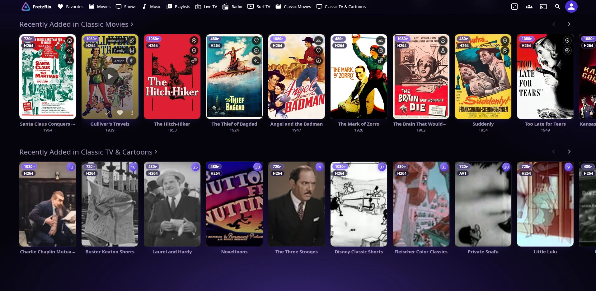

# Fretzflix Night

A black and purple glass theme for Jellyfin 12: a near-black background with a purple glow, glass menus with a purple rim, and rounded cards that light up on hover.

One CSS file. No fonts or anything else loaded from outside your server.

> Built with Claude for my own server and shared as is. Tested on Jellyfin 12.4 (web, Jellyfin Media Player, phone apps). Issues and pull requests are welcome.

## Install

1. Dashboard -> General -> Branding -> **Custom CSS**.
2. Paste all of [`fretzflix-night.css`](fretzflix-night.css) and click **Save**.
3. Reload the page.

To remove it, clear the box and save.

**Works in** web-based clients: browsers, Jellyfin Media Player (including its older engine), and the official phone, Samsung and LG apps. Native Android TV, Roku and Apple TV apps ignore custom CSS.

## Changing the colors

Edit the variables at the top of the file: `--fz-violet`, `--fz-violet-hi`, `--fz-violet-deep` and their `-rgb` versions.

## After a Jellyfin update

- The newer parts of Jellyfin (top bar, menus) use its palette variables, so they follow the theme automatically.
- The older parts (cards, sliders, the player) hard-code Jellyfin's blue, `#00a4dc`, so the theme overrides them one by one.
- If blue spots come back, search the loaded stylesheets for `00a4dc` and add the new selectors, or open an issue with a screenshot.

## License

MIT, see [LICENSE](LICENSE).
