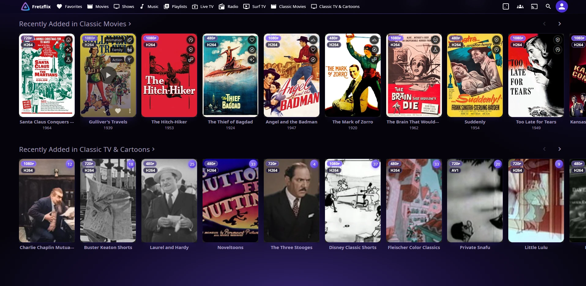

# Fretzflix Night

A black and purple theme for Jellyfin 12. It gives you a near-black background with a purple glow rising from the bottom, a glass top bar and menus with a purple rim, rounded cards with a purple edge that lights up on hover, and item pages that show the show's art under a dark purple veil.

It's one CSS file with no fonts or anything else loaded from outside your server, so your users' browsers don't contact any third party.

> Built with Claude for my own server and shared as is. It works on my setup (Jellyfin 12.4, web client, Jellyfin Media Player, and the phone apps). Issues and pull requests are welcome, and I'll update it as needed.

## Install

1. In Jellyfin, go to **Dashboard > General > Branding > Custom CSS**.
2. Paste the whole of [`fretzflix-night.css`](fretzflix-night.css) and click **Save**.
3. Reload the page.

Everyone using a web-based client sees it on their next page load: browsers, Jellyfin Media Player, and the official phone, Samsung and LG apps. The native Android TV, Roku and Apple TV apps ignore custom CSS, so they keep the stock look.

To remove it, clear the box and save.

## Changing the colors

The colors are CSS variables at the top of the file (`--fz-violet`, `--fz-violet-hi`, `--fz-violet-deep` and their `-rgb` versions). Change those and the whole theme follows.

## After a Jellyfin update

Jellyfin 12 styles its pages two ways. The newer parts (top bar, menus, drawers) read Jellyfin's palette variables, so the theme recolors them all at once. The older parts (cards, progress bars, sliders, the player) hard-code Jellyfin's stock blue, `#00a4dc`, so the theme overrides those one by one.

If a big update brings blue spots back, search the page's loaded stylesheets for `00a4dc` (browser dev tools work fine) and add the new selectors to the matching section of the file. Or open an issue with a screenshot.

## License

MIT. See [LICENSE](LICENSE).
